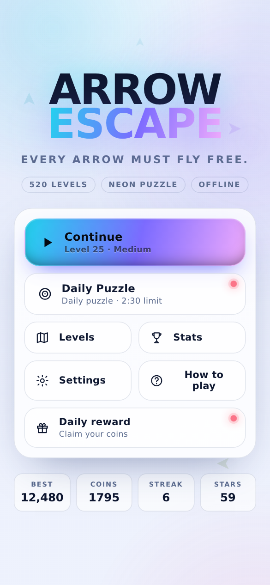
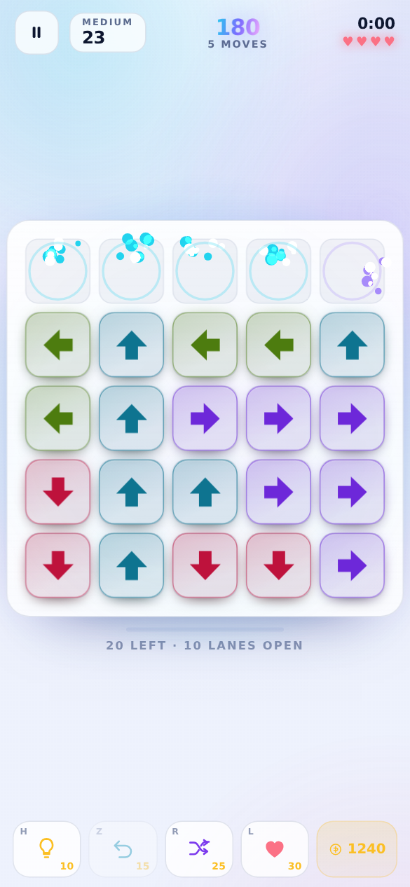
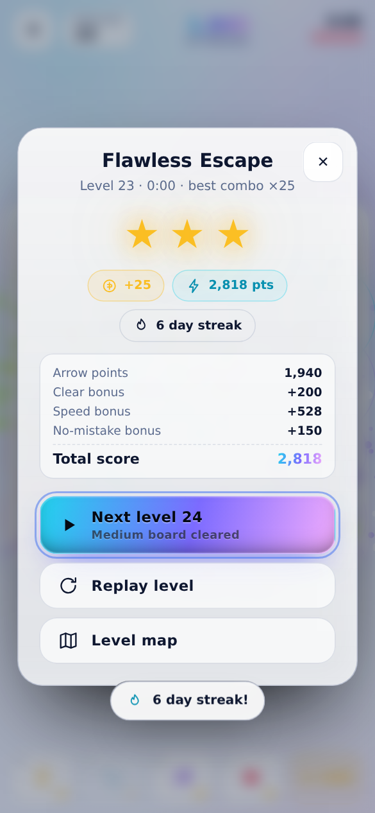

# ⚡ Arrow Escape — Neon Puzzle

Every arrow wants out. Tap it, and it flies free — **but only if its runway is clear**.
Clear the whole board to win. 520 levels, 4 difficulty bands, power-ups, daily puzzles and a
fully offline, installable UI.

No build step, no dependencies, no external assets: plain **HTML + CSS + JavaScript (ES modules)**.

```bash
npm start                 # -> http://localhost:4173   (python3 -m http.server 4173)
open index.html           # also fine - no bundler needed
npm run build             # -> dist/arrow-escape.html  (one file, works from file://)
npm test                  # 3,406 logic + 95 DOM/boot assertions
```

> **Zero install:** to just play, open `dist/arrow-escape.html` (built copy, everything
> inlined, runs offline by double-click) or serve the folder and open `index.html`.

| Title | Board | Level map | Win |
|---|---|---|---|
|  |  |  |  |

<sub>Light theme is one tap away in Settings.</sub>

---

## 🎮 Mera Game Plan (tumhare 3 sawaalon ka jawaab)

**1. Gameplay type → Arrow Escape (arrows ko grid se bahar nikalna hai).**
Arrow Path aur Arrow Sort se ye zyada instantly-readable hai: player 1 second mein samajh jaata hai
ki kya karna hai, aur har tap ka feedback clear hai. Isi liye core loop "pehle 10 second" mein hi
mazedaar ho jaata hai.

**2. Design style → Neon Glow (dark base) + poora Light theme bhi.**
Dark navy background par cyan / violet / rose / lime arrows — har direction ka apna colour, jisse
board scan karna aasan ho. Ek tap se Light theme (Minimal-ish clean white) bhi milta hai, kyunki
kuch players bright UI prefer karte hain.

**3. Platform → Browser first, Android-ready.**
Abhi ye ek PWA hai: installable, offline-capable, mobile-first responsive. Baad mein isi codebase ko
Capacitor se wrap karke Play Store par daal sakte ho (neeche roadmap).

**Extra:** har 10th level ek **challenge** (bada board, kam lives, double coins), aur roz ek naya
**Daily Puzzle** — dono deterministic hain, yaani sab devices par same puzzle.

---

## 🕹️ How to play

1. **Tap / click** an arrow (keyboard: move with arrows/WASD, fire with Enter).
2. The arrow flies in the direction it points — **only if nothing blocks its lane**.
3. **Blocked arrow** → screen shake, red flash, −1 ❤️ and your combo resets.
4. Clear every arrow to finish the level.

### The lane rule (important!)

A "lane" is the straight line an arrow travels on. Each lane is **3 cells wide**, so an arrow only
collides with other arrows whose column (for vertical arrows) or row (for horizontal arrows)
shares the same **index modulo 3**.

> Example on a 7×7 board: an arrow at row 1 pointing **down** is blocked by arrows at rows 4 and 7 —
> but arrows at rows 2, 3, 5, 6 are sitting in a *different lane* and do not block it.

Isi wajah se puzzle mein asli depth aati hai: door ka arrow bhi tumhe rok sakta hai, aur paas ka
arrow kabhi bhi beech mein nahi aata. Jab bhool jao, **💡 Hint** beam dikha dega ki kaunsi lane
clear hai.

**Koi dead-end nahi:** jo bhi legal move tum karte ho, board solvable rehta hai — sirf blocked taps
tumhe nuksaan pahunchate hain. Isliye game kabhi "unwinnable" nahi hota.

---

## ✨ Features

| Requirement | Kya bana |
|---|---|
| **Arrow Escape puzzle** | 4×4 → 8×8 boards, 520 levels, har level pe naya puzzle |
| **500+ levels, 4 tiers** | Easy (1–20), Medium (21–60), Hard (61–140), Expert (141–520), 52 chapters |
| **Special challenge every 10 levels** | Level 10, 20, 30… bada board + kam lives + 2.5× coins + 👑 badge |
| **💡 Hint** | Beam ke saath exact free arrow highlight (authored solution se) |
| **↩️ Undo** | Poora state restore — score, combo, lives, moves |
| **🔀 Shuffle** | Confirm ke baad naya layout, lives refill, score/timer chalu |
| **❤️ Extra life** | +1 life, game-over par "Continue" bhi |
| **Coins + 3-star rating** | Stars = clean + fast play; coins stars aur difficulty se scale |
| **Daily rewards** | 7-day login calendar (25 → 300 coins), streak tracking |
| **Achievements + streaks** | 20 achievements, day-streak fire counter, 3/7/30-day milestones |
| **Celebration** | Confetti burst, star pop, shockwave ring, board shake, victory arpeggio |
| **Juice** | Escape burst particles, combo pops, floating +points, blocked shake, coin pops |
| **Sound** | Fully synthesised WebAudio SFX (no files) + generative music bed |
| **Dark + light mode** | One tap theme switch, persisted |
| **Vibration** | Haptic patterns for tap / fly / block / win / lose |
| **Timer + move counter** | Count-up clock (timed countdown on Hard/Expert/challenges) |
| **Daily puzzle + offline** | Deterministic daily board, service worker cache, localStorage save |
| **Mobile-first UI** | Safe-area insets, 44px+ touch targets, landscape layout |
| **Progress save** | Levels, stars, coins, streaks, achievements, high scores, settings |
| **Settings** | Sound, music, vibration, theme, reset progress |
| **Start / pause / game over** | Instant restart (one tap), pause modal with live stats |
| **Local high score table** | Top 10 runs with level, stars, date |
| **60 fps** | Single rAF particle canvas, CSS-composited arrow transforms, throttled HUD |

---

## 💰 Economy & progression

- **Arrow points:** `20 + min(combo−1, 9) × 8` — chaining escapes is the best scoring strategy.
- **Level bonus:** 200 (+150 on challenge) + speed bonus + 150 for a mistake-free clear.
- **Coins:** `(10 + stars × 5) × (challenge ? 2.5 : 1)`; daily puzzle pays 40+.
- **Power-ups:** Hint 10 · Undo 15 · Shuffle 25 · Extra life 30 (new players start with 120).
- **Stars:** 3 = zero blocked moves *and* under par time · 2 = near-perfect · 1 = cleared.
- **Streak:** any cleared level keeps the fire alive; a missed day resets it.

---

## 🧱 Tech & structure

```
index.html                 app shell (all screens, a11y labels)
manifest.webmanifest       PWA metadata
sw.js                      offline app-shell cache
styles/app.css             design tokens, chrome, screens, modals
styles/game.css            board, arrows, HUD, FX
js/main.js                 screens, level map, rewards, settings, wiring
js/game.js                 level runtime: clock, input, powers, results
js/board.js                DOM board renderer + animations
js/engine.js               pure puzzle rules (no DOM)
js/levels.js               procedural generation + tuning + ratings
js/achievements.js         achievements, streaks, login calendar
js/audio.js                synthesised SFX + generative music
js/haptics.js              vibration patterns
js/fx.js                   particle canvas, confetti, shake
js/storage.js              versioned localStorage profile
js/ui.js                   modal + toast system
tests/                     node test suites (logic + jsdom boot)
```

### Level generation (why every puzzle is always solvable)

Levels are generated **backwards**: start from a completely full board, then repeatedly pick a cell
whose runway in some direction is free, give it that direction and remove it. The removal order is
therefore *a* valid solution — used for hints. The generator retries until the opening position is
tangled enough (only ~30–60 % of arrows can move on the first turn), which is what makes big boards
feel hard. Seeds come from the level number, so level 137 is identical on every device, forever.

Because escaping an arrow can only *unblock* other arrows, any board reachable by legal moves stays
solvable — no unwinnable states, no soft-locks.

### Controls

| Action | Touch / mouse | Keyboard |
|---|---|---|
| Fire arrow | tap arrow | arrow keys / WASD + `Enter` |
| Hint | 💡 | `H` |
| Undo | ↩️ | `Z` |
| Shuffle | 🔀 | `R` |
| Extra life | ❤️ | `L` |
| Pause | ❚❚ | `P` / `Esc` |

---

## 📱 Android packaging (next step)

```bash
npm run build                       # single-file bundle in dist/
npx cap init "Arrow Escape" com.you.arrovescape --web-dir=dist-deploy
npm i -D @capacitor/cli @capacitor/core @capacitor/android
npx cap add android
npx cap open android      # Android Studio → build APK / AAB
```

Everything is already mobile-ready: relative asset paths, safe-area padding, no network calls,
haptics via `navigator.vibrate` (Capacitor Haptics plugin can replace `js/haptics.js` in one file).

---

## 🧪 Tests

```bash
npm test
```

- `tests/logic.test.mjs` — every one of the 520 levels is replayed through its authored solution,
  random legal play is proven never to dead-end, hints are verified at every step, undo restores
  exact state, ratings/coins behave, 90 future daily puzzles validated. (3,406 assertions, ~0.3 s)
- `tests/dom.test.mjs` — boots the real app in jsdom and drives it end-to-end: tap, block, hint,
  undo, life, keyboard play, pause/resume, win modal, next level, game over + retry, 520-button
  level map, theme switch, daily puzzle, localStorage persistence. (74 assertions)

---

## 🗺️ Ideas for v1.1

- Frozen / locked arrows and one-way portals for Expert tier variety
- Endless zen mode with no lives
- Cloud sync for the profile
- Localised strings (Hindi / English / Spanish)
- Weekly tournament board using seeded dailies

---

## 🎯 Design notes (why it feels good in the first ten seconds)

1. **One rule, one gesture.** Tap the arrow. No tutorial wall — level 1 is a 4×4 board
   where six arrows can already fly, so the *first tap always works*.
2. **Instant, loud feedback.** Every escape fires a particle burst along its travel direction,
   a shockwave ring, a pitch-rising whoosh (higher combo → higher pitch) and a floating `+points`.
   Blocked taps answer with a red flash, a board shake and a buzz.
3. **Combos create greed.** Points scale with the chain and a 3-combo pops a big COMBO label, so
   players start hunting the next free lane instead of tapping at random.
4. **Fail forward.** Lives are a resource, not a punishment: a "Continue" offer, a reshuffle and
   *instant* restart (one tap, no confirm) keep the loop under two seconds.
5. **Puzzle honesty.** There is always a legal move and hints always point at one — a loss is
   always the clock or the block counter, never a dead board.

Performance choices: arrows move with `transform` only (compositor), particles run in a single
rAF loop with a DPR-capped canvas, the ambient orbs freeze during play so blurred chrome isn't
re-sampled every frame, dense boards drop the per-arrow SVG glow, and the HUD only writes DOM when
values change (the clock ticks 5×/s, not 60×/s).
